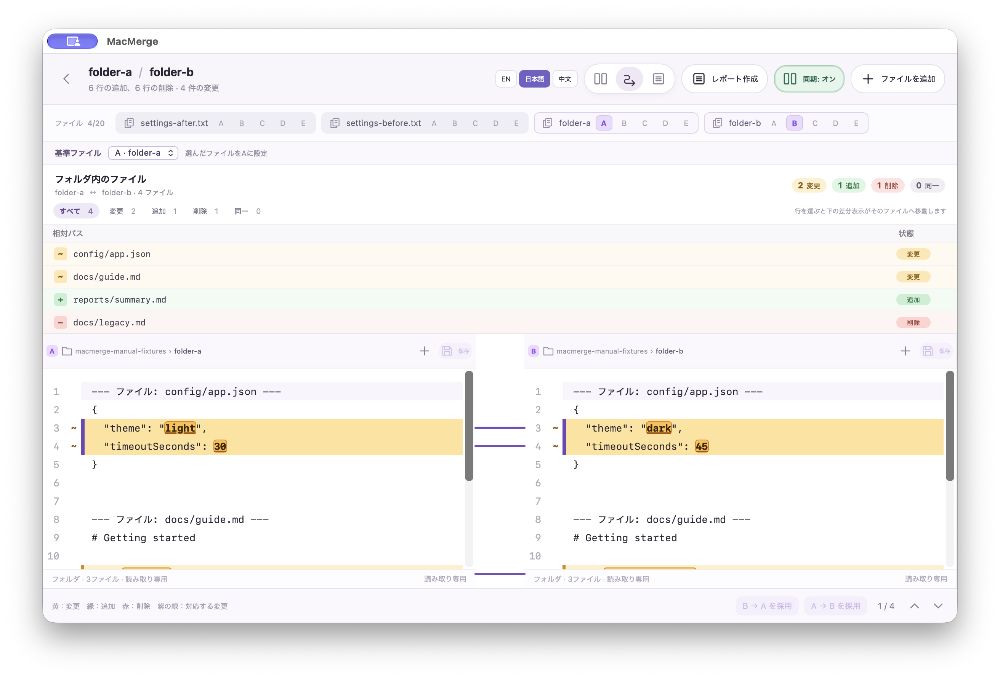

# MacMerge 操作マニュアル

MacMergeは、テキストや文書から抽出した文字を並べて差分を確認するデスクトップアプリです。ファイルはこの端末内で処理されます。

## まずは2つのファイルを比べる

1. 開始画面で「ファイルを開く」を選び、比較するファイルを2つ選択します。ファイルを開始画面へドラッグ＆ドロップしても開けます。
2. 比較画面で基準にするファイルをAに設定します。A〜Eのボタンで、各ファイルを表示する列を割り当てます。
3. 「左右に並べる」「Fluid View」「統合表示」から見やすい表示方法を選びます。差分位置のマーカー、または下部の「前の変更」「次の変更」で変更箇所を移動できます。

一度に最大20ファイルを開けます。比較画面に表示するのは最大5ファイルです。3つ以上のファイルを開くと、Aを基準に複数の比較ペアを切り替えられます。

## 差分を確認して反映する

- **黄色**は変更、**緑**は追加、**赤**は削除を示します。紫の線は対応する変更箇所を結びます。
- テキストファイルでは、比較画面上で内容を編集できます。「B → Aを採用」または「A → Bを採用」で相手側の変更を反映し、保存ボタンでそのファイルへ書き込みます。
- PDF、Office文書、フォルダ比較は読み取り専用です。抽出した文字列を比較しますが、元の文書へ変更を書き戻すことはできません。
- 「同期: オン」は左右のスクロール位置を連動させます。必要に応じてオフにできます。

## フォルダを比べる

1. 開始画面で「フォルダ比較」を選び、比較する2つのフォルダを指定します。
2. 比較結果の一覧で、相対パスごとの変更・追加・削除・同一を確認します。状態で絞り込み、ファイルを選んで本文を確認できます。
3. 「レポート作成」でHTMLレポートを保存します。レポートには件数と状態一覧に加え、差分ファイルの本文が含まれます。

この画面では、Aのフォルダを基準にBを比べています。上部の一覧からファイルを選ぶと、下に両側の内容が表示されます。黄色は変更、緑は追加、赤は削除です。

画像などの対応外ファイルやシンボリックリンクは比較対象から除外されます。`.git`、`node_modules`、`target`などの生成・依存フォルダも検索しません。

## 対応形式と上限

- UTF-8テキスト
- PDF（文字を抽出できるもの）
- DOCX、ODT、PPTX、XLS、XLSX、ODS
- フォルダ内の対応ファイル

1ファイルは20MB以下、開いているファイル全体は100MB以下、フォルダは2,000ファイル・合計50MBまでです。スキャンPDFのOCR、画像やレイアウトの比較、Office文書の書式比較、パスワード保護PDFには対応していません。

## サンプルで試す

リポジトリ内の[テキスト比較サンプル](../samples/diff-demo/README.md)と[フォルダ比較サンプル](../samples/folder-diff-demo/README.md)を使えます。保存動作を試す場合は、サンプルを複製してから開いてください。

## 言語を切り替える

画面のEN / 日本語 / 中文ボタンで表示言語を変更できます。選択は次回起動時にも保持されます。
